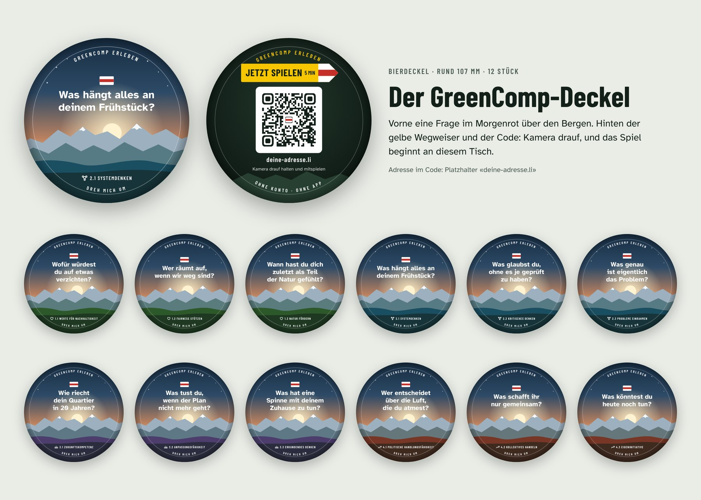

# Der GreenComp-Deckel

Der Bierdeckel ist das Werbemittel des Spiels. Er liegt dort auf dem Tisch, wo Leute zusammensitzen: in der Beiz, im Vereinslokal, am Fest. Jemand hält die Handykamera auf den Code und landet direkt im Spiel, an genau diesem Tisch.

Damit das funktioniert, muss man den Deckel **wiedererkennen**: auf dem Tisch, auf einem Foto, in der App. Deshalb gibt es nur eine einzige Zeichnung (`deckel.js`). Sie dient für die Druckdaten, für den Deckel auf der Startseite der App und für die Seite nach dem Scan. Was man in der Hand hält, sieht man auch auf dem Handy.

## Die fünf Erkennungszeichen

Diese fünf Dinge bleiben auf jedem Deckel gleich:

1. **Rund wie ein echter Bierdeckel**, mit der Ringschrift «GreenComp erleben».
2. **Vorne Morgenrot über den Bergen** und eine Frage, die neugierig macht. Darüber die weiss-rot-weisse Wegmarkierung.
3. **Hinten der gelbe Wegweiser «Jetzt spielen · 5 min»** mit weiss-rot-weisser Spitze, wie auf Schweizer Bergwanderwegen.
4. **Der Code in einem weissen Feld**, in der Mitte die Wegmarkierung.
5. **Farbe und Zeichen des Bereichs** (Herz, Netz, Sonnenaufgang, steigender Pfeil) zeigen, welcher der zwölf Deckel es ist.

Dieselben Zeichen tragen die App, das Symbol auf dem Startbildschirm (dunkel, Wegmarkierung, gelber Wegweiser) und der «Spielen»-Knopf.

## Die zwölf Deckel

Jeder Deckel hat seine eigene Frage und seine eigene Adresse. Der Code führt auf genau diesen Deckel.

| Nr. | Adresse | Kompetenz | Frage vorne |
|---|---|---|---|
| 1 | `#d1` | 1.1 Werte für Nachhaltigkeit | Wofür würdest du auf etwas verzichten? |
| 2 | `#d2` | 1.2 Fairness stützen | Wer räumt auf, wenn wir weg sind? |
| 3 | `#d3` | 1.3 Natur fördern | Wann hast du dich zuletzt als Teil der Natur gefühlt? |
| 4 | `#d4` | 2.1 Systemdenken | Was hängt alles an deinem Frühstück? |
| 5 | `#d5` | 2.2 Kritisches Denken | Was glaubst du, ohne es je geprüft zu haben? |
| 6 | `#d6` | 2.3 Probleme einrahmen | Was genau ist eigentlich das Problem? |
| 7 | `#d7` | 3.1 Zukunftskompetenz | Wie riecht dein Quartier in 20 Jahren? |
| 8 | `#d8` | 3.2 Anpassungsfähigkeit | Was tust du, wenn der Plan nicht mehr geht? |
| 9 | `#d9` | 3.3 Erkundendes Denken | Was hat eine Spinne mit deinem Zuhause zu tun? |
| 10 | `#d10` | 4.1 Politische Handlungsfähigkeit | Wer entscheidet über die Luft, die du atmest? |
| 11 | `#d11` | 4.2 Kollektives Handeln | Was schafft ihr nur gemeinsam? |
| 12 | `#d12` | 4.3 Eigeninitiative | Was könntest du heute noch tun? |

## Was nach dem Scan passiert

1. **Wiedererkennen:** Die Seite zeigt den gescannten Deckel, zuerst die Rückseite mit dem Code, dann dreht er sich zur Frage.
2. **Ein Tipp bis zum Spiel:** «Jetzt spielen · 5 Minuten» startet das Spiel für die Gruppe am Tisch, mit genau dieser Karte und ohne Namen eintippen. Daneben: allein als Spaziergang, das ganze Spiel (60 Min.), mehr zur Karte.
3. **Sammeln:** «Gefundene Deckel: 3 von 12». Ab drei Deckeln gibt es das Fundstück «Deckel-Jagd». Das lädt ein, auch die anderen Deckel zu suchen.
4. **Weitergeben:** «Lasst den Deckel für die Nächsten liegen, oder nehmt ihn mit und gebt ihn weiter.»
5. **Vertrauen:** Kein Konto, kein Tracking. Welcher Deckel gescannt wurde, steht nur im Teil der Adresse nach dem `#`. Dieser Teil geht nicht ans Netz und bleibt auf dem Handy.

## Technische Angaben

| | |
|---|---|
| Format | rund, 107 mm (übliche Grösse) |
| Datenformat | 113 × 113 mm, 3 mm Beschnitt rundum |
| Sicherheitsabstand | 4 mm: alles Wichtige liegt innerhalb von 99 mm |
| Druck | beidseitig, vierfarbig (CMYK) auf Bierdeckelkarton |
| QR-Code | weisses Feld 43 mm, Code etwa 35 mm, Ruhezone 4 Module, Fehlerkorrektur H (30 %), Wegmarkierung in der Mitte (rund 5 % der Fläche) |
| Lesbarkeit | Faustregel 1:10: Aus 30 cm Abstand reichen 3 cm Code. |
| Adresse | kurz halten. Eine kurze Adresse macht die Punkte des Codes grösser. |
| Schriften | Atkinson Hyperlegible, Barlow Condensed (SIL Open Font License) |

**Druckdaten erzeugen:** Die Seite «Der Deckel» (`#deckel`) öffnen und «Für die Druckerei» wählen. Dann «Drucken oder als PDF sichern» klicken, im Druckdialog «Als PDF sichern», Ränder «Keine», Skalierung 100 %.
- Das PDF hat 24 Seiten: je Deckel eine Vorder- und eine Rückseite.
- Es ist vektoriell und enthält die Schriften. Chrome rundet die Seite auf 320 pt, das sind 112,9 mm. Das liegt im Beschnitt.
- Für Gestalterinnen und Gestalter gibt es jede Seite auch als SVG. Dort die Schriften vor dem Druck einbetten oder in Pfade wandeln.
- «Probedruck auf A4» legt zwei Deckel auf eine A4-Seite, mit Schnittlinie (magenta) und Sicherheitslinie (blau).

**Vor dem Druck:** die Vorlage der Druckerei holen und Beschnitt und Sicherheitsabstand vergleichen. Die Werte schwanken je nach Anbieter. Nach einem nachhaltigen Karton fragen (Recycling oder FSC), das passt zum Thema.

## Geprüft (16. Oktober 2026)

- Alle 12 Codes wurden aus der Druckzeichnung gelesen, mit dem Decoder jsQR:
  - grob, 3,8 Pixel pro Millimeter, das ist weniger als jede Handykamera liefert;
  - fein, 11 Pixel pro Millimeter;
  - mit kurzer Adresse (`greencomp.li`) und mit langer Adresse (GitHub Pages).
  - Ergebnis: 36 von 36 gelesen.
- Die Druckdaten für die Druckerei haben 24 Seiten, je 113 × 113 mm, und enthalten alle vier Schriftschnitte. Der A4-Probedruck hat 12 Seiten mit je zwei Deckeln.
- **Noch offen:** Ein echter Probedruck auf Karton, gescannt mit drei Handys (iPhone, Android, ein älteres) bei Beizenlicht aus 30 cm.

## Wo die Deckel liegen können

- Beizen, Cafés und Vereinslokale, besonders an Tischen, wo Gruppen sitzen.
- Gemeindeanlässe, Feste, Märkte, Tagungen.
- Bibliotheken, Jugendtreffs, Mensen: als Untersetzer ohne Bierbezug.
- Bei der Expedition als **Stationsmarke**: An jeder Station liegt ein Deckel in der Farbe des Bereichs. Die Bereichskarten bleiben bei der Gruppe.
- Bei Spielen mit dem Kartenset: Jede Person nimmt am Schluss einen Deckel mit nach Hause.

## Messen, ohne zu tracken (Vorschlag, nicht gebaut)

Die App zählt nichts zentral. Wer wissen will, welche Orte funktionieren, kann jedem Deckel eine eigene kurze Adresse auf dem eigenen Server geben, zum Beispiel `greencomp.li/7`. Der Server leitet weiter und zählt nur die Aufrufe pro Deckel, ohne Cookies und ohne IP-Adressen zu speichern.

## Quellen

- Druckvorlage runder Bierdeckel 107 mm, Datenformat 113 × 113 mm, 3 mm Beschnitt, CMYK (flyeralarm): [Datenblatt](https://druck.proxysto.re/datasheet/392/321285.pdf)
- QR-Code, Mindestgrösse und Abstand: [QR Code Minimum Size Guidelines (QR Code Generator)](https://www.qr-code-generator.com/blog/qr-code-distance/), [Minimum size of a QR Code (QRplanet)](https://qrplanet.com/help/article/what-is-the-minimum-size-of-a-qr-code), [Minimum size (Deloitte QR)](https://qr.deloitte.com/help/en/article/what-is-the-minimum-size-of-a-qr-code)
- QR-Code, Fehlerkorrektur, Logo, Ruhezone: [The complete guide to QR codes (DEV)](https://dev.to/bitran/the-complete-guide-to-qr-codes-error-correction-logos-and-best-practices-54o5), [How to print a QR code (QRplanet)](https://qrplanet.com/help/article/how-to-print-qr-code)
